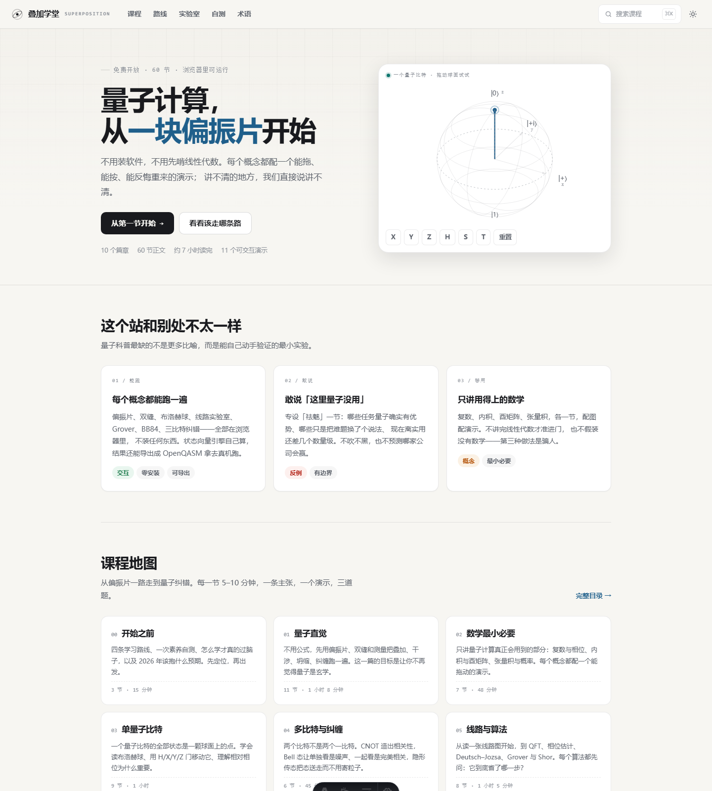
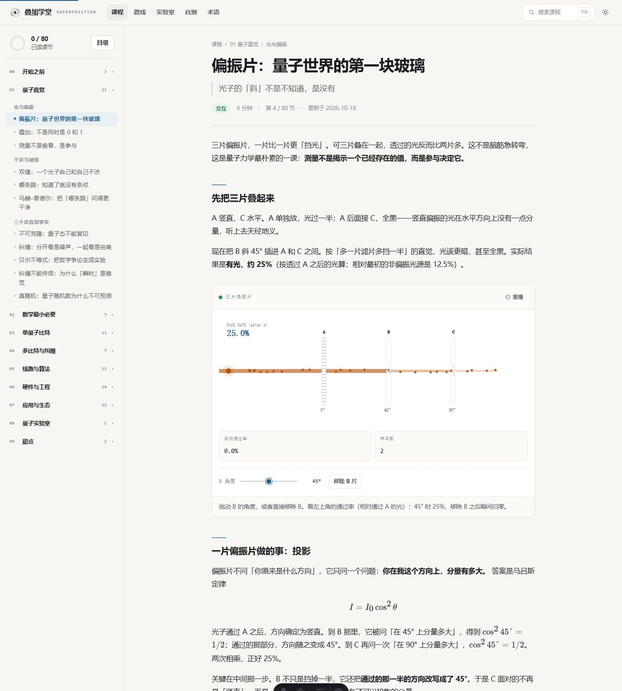
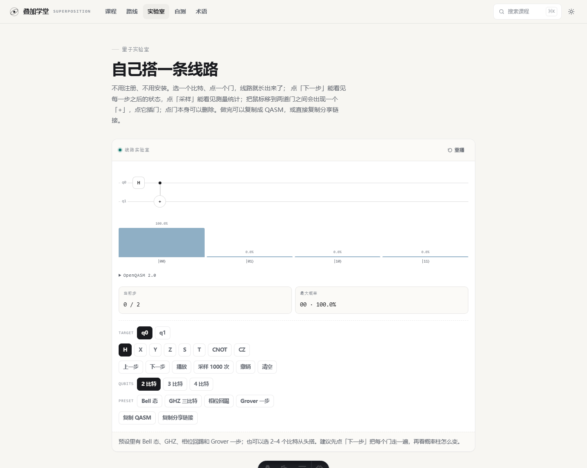

# 叠加学堂 · Superposition Academy

中文量子计算学习与科普站。静态站，每个概念都配一个能在浏览器里跑的演示。

- **课程**：10 个篇章、60 节正文、181 道自测题，每节 5–10 分钟
- **演示**：11 个交互组件（偏振片、双缝、布洛赫球、线路实验室、Grover、BB84、三比特纠错……）
- **实验室**：2–4 比特自由搭线，插入/删除门、单步执行、采样、导出 QASM、复制分享链接（线路编码在 URL 里）
- **引擎**：自研 `qsim`，零依赖 TypeScript 状态向量模拟器，支持 1–14 比特、采样、布洛赫矢量、OpenQASM 2.0 导出
- **构建产物**：纯静态，零后端，可托管在任意 CDN

> 开发过程、关键决策、已知问题与下一步，都记在 [docs/DEVLOG.md](docs/DEVLOG.md)；部署步骤见 [docs/DEPLOY.md](docs/DEPLOY.md)。换人或换会话时，先读这两份就能接上。

## 预览







## 技术栈

| 层 | 选择 |
|---|---|
| 框架 | Astro 7（静态输出，默认零 JS） |
| 内容 | MDX + `astro:content` 内容集合（zod 校验） |
| 公式 | remark-math + rehype-katex |
| 交互 | 原生 TypeScript 岛，按视口懒加载 |
| 搜索 | Pagefind（构建期索引）+ 构建期 JSON 回退 |
| 测试 | Vitest（qsim 与 numpy 参照值逐振幅比对） |

## 本地开发

```bash
npm install
npm run dev          # http://localhost:4321
npm run build        # 构建 + Pagefind 索引
npm run preview      # 预览构建产物
npm test             # qsim 测试
npm run check:content # 内容闸门
```

## 目录

```
src/
├─ content/lessons/      课节 MDX（按篇章分目录）
├─ data/course.ts        篇章与主题结构
├─ data/glossary.ts      术语表（<Term id> 引用）
├─ lib/qsim/             量子线路仿真引擎
├─ lib/course.ts         课程加载、排序、上下节
├─ layouts/              BaseLayout / LessonLayout
├─ components/           Demo、Quiz、Sidebar、Callout…
├─ scripts/              站点交互、11 个演示组件
├─ styles/               设计令牌与样式
└─ pages/                首页、课节、目录、路线、实验室、自测、术语、关于
```

## 写一节新课

1. 读 `CONTENT_GUIDE.md`。
2. 在 `src/content/lessons/<篇章>/` 新建 `NN-slug.mdx`，frontmatter 按规范填。
3. `npm run check:content` 过闸门。
4. `npm run dev` 看效果；演示来自 `src/scripts/demos/`，按 `kind` 引用。

内容闸门会检查：字数、thesis 长度、题目数量与选项、解析长度、来源、演示声明与正文是否一致、术语 id、禁词、slug/order 唯一性。

## 测试

`npm test` 会用手写的 numpy 参照实现（`scripts/golden.py`）逐振幅校验 `qsim`：

```bash
python scripts/golden.py   # 重新生成 tests/golden.json
npm test
```

覆盖 H、Bell、GHZ、Grover 两步、受控相位、swap、布洛赫矢量、纯度、采样一致性、测量坍缩、QASM 导出等 28 项。

## 部署

Cloudflare Pages / Vercel / Netlify 均可，构建命令 `npm run build`，输出目录 `dist`。逐步说明（建仓库、连接、环境变量、验收清单、绑域名、排错）见 [docs/DEPLOY.md](docs/DEPLOY.md)。

```bash
# 国内访问若需备案，可将同一份 dist 同步到对象存储 + CDN
npm run build && rsync -av dist/ user@host:/var/www/quantum/
```

站点域名由环境变量 `PUBLIC_SITE_URL` 控制：本地不设会回退到占位域名；部署时在平台里设为实际网址，canonical、sitemap、OG、RSS 会一起跟着变。

## 授权

正文与插图 CC BY-NC-SA 4.0；代码 MIT。
